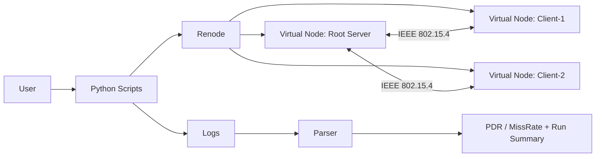
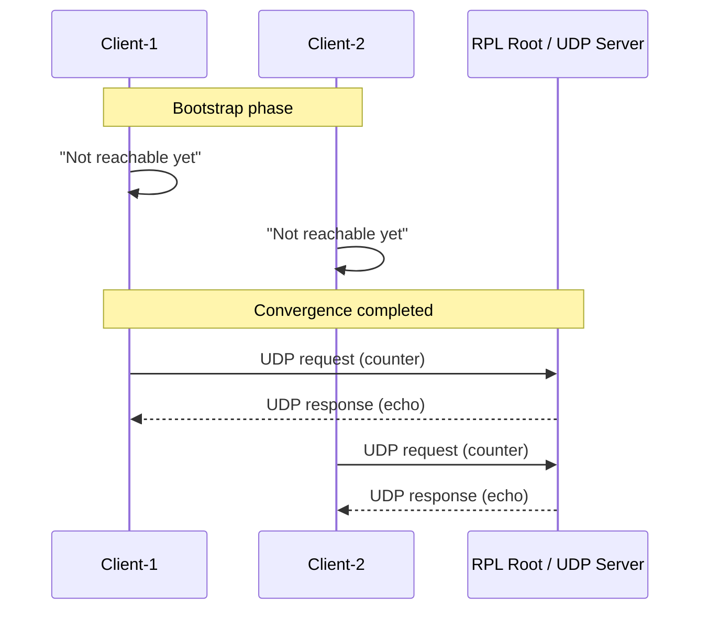
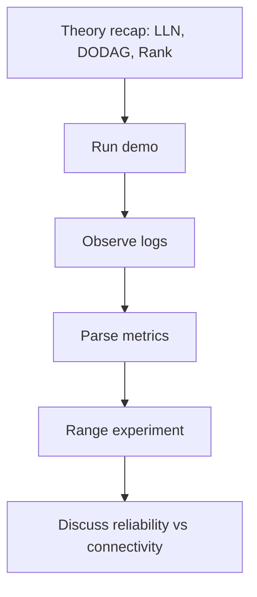
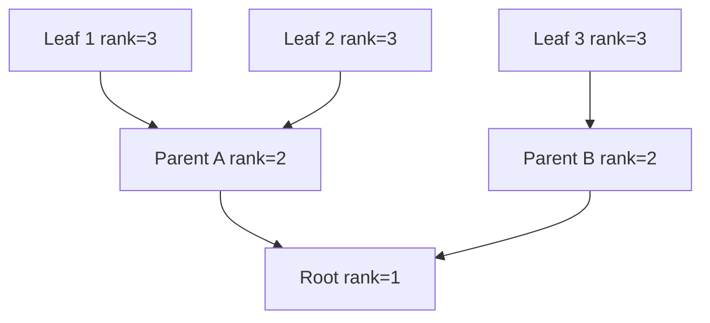
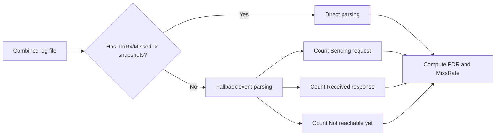

# Contiki RPL Lab for Industrial IoT Course

Hands-on repository to demonstrate and analyze RPL with Contiki-NG and Renode.

This repository includes:
- concise protocol theory,
- step-by-step execution instructions,
- reproducible experiments,
- automation scripts and log parsing utilities.

---

## Visual overview (Mermaid)

### A) Lab architecture



### B) RPL behavior in this lab



### C) Workflow overview



---

## 1) Learning goals

After this lab, users should be able to:
- explain what problem RPL solves in Low-power and Lossy Networks (LLNs),
- describe RPL roles (root, parents, leaf nodes) and DODAG formation,
- run a multi-node RPL scenario in Renode,
- interpret logs and calculate simple reliability metrics (`PDR`, `MissRate`),
- reason about how radio range and topology affect routing performance.

---

## 1.1 Super-simple explanation

- Imagine many tiny IoT devices trying to send data to one central device.
- Not all devices can reach the center directly.
- So each device chooses a "next helper node" (a parent) to move data upward.
- Over time, a tree-like structure appears (the DODAG), with the root at the top.
- At first, devices may say "Not reachable yet".
- After convergence, packets start flowing and responses come back.

In one sentence:
- **RPL helps constrained IoT devices find stable upward paths to a root over weak wireless links.**

---

## 2) RPL theory (simple explanation)

### 2.1 Why RPL exists

Traditional routing protocols are often too heavy for IoT devices:
- little RAM/flash,
- low CPU power,
- battery constraints,
- unstable wireless links.

RPL is designed specifically for these constraints.

RPL is routing made for tiny, battery-powered devices and imperfect wireless links.

### 2.2 Core concepts

- **LLN (Low-power and Lossy Network)**: constrained nodes + unreliable links.
- **DODAG**: a directed acyclic graph built toward a destination (typically the root).
- **Root**: central reference node (in this lab, the UDP server).
- **Parent**: next-hop selected by each node according to an objective function.
- **Rank**: a logical distance from the root used to avoid loops.

Quick analogy:
- Root = destination hub
- Parents = forwarding helpers
- Rank = distance level from the root

Mermaid view of a simple DODAG:



### 2.3 RPL control messages (high-level)

- **DIS**: asks for routing information.
- **DIO**: advertises DODAG information.
- **DAO**: advertises downward reachability (used depending on mode).

For this lab, packet-level bit fields are not required; behavior-level understanding is sufficient.

### 2.4 Observable behavior in this lab

In `rpl-udp`, clients initially print:
- `Not reachable yet`

Then, after convergence:
- `Sending request ...`
- server prints `Received request ...`
- clients print `Received response ...`

This transition is the visible effect of DODAG setup and route usability.

---

## 2.5 Tiny glossary

- **Convergence**: the period where routes are still forming.
- **Reachable**: node has a usable route to the root.
- **Unreachable**: no working route yet.
- **PDR**: fraction of packets that successfully complete end-to-end.
- **Topology**: who can directly talk to whom in the wireless network.

---

## 3) Repository structure

- `contiki-ng/`  
  Vendored Contiki-NG source tree (included in this repo).

- `run_rpl_lab_interactive.py`  
  Interactive experiment runner:
  1. generates `.resc` scripts in `contiki-ng/examples/rpl-udp/`,
  2. runs `make renode TARGET=cc2538dk SCRIPT=<file>.resc`,
  3. stores logs in `rpl_lab_runs/`.

- `parse_rpl_udp_logs.py`  
  Parser for:
  - `Tx/Rx/MissedTx` snapshots (preferred),
  - fallback combined-log parsing (`Sending request` / `Received response` / `Not reachable yet`).

- `run_renode_container_demo.sh` + `rpl-container-demo.resc`  
  One-command Docker demo (no local Renode install needed).

- `rpl_story_demo.py`  
  Converts log events into a 4-step protocol narrative.

- `lab - RPL.pdf` / `lab - RPL.pptx`  
  Slide material.

---

## 4) Prerequisites

Install:
- Python 3.9+
- Git
- **One of**:
  - local Renode installation, or
  - Docker (for containerized demo)

Optional but recommended:
- Wireshark (if you want traffic-level inspection in supported setups).

---

## 5) Suggested execution flow

1. Review RPL core concepts (LLN, DODAG, rank).
2. Run the container demo and inspect logs.
3. Run baseline experiment and parse metrics.
4. Run range experiment and compare outputs.
5. Summarize reliability trends and convergence behavior.

---

## 6) Quick start (step-by-step)

Run all commands from repository root.

### Step 1 - Verify bundled Contiki path

Check that this exists:
- `./contiki-ng/examples/rpl-udp`

### Step 2 - Baseline experiment

```bash
python3 run_rpl_lab_interactive.py \
  --contiki-path /absolute/path/to/this-repo/contiki-ng \
  --mode baseline \
  --run-seconds 90
```

Expected behavior:
- script generates a Renode `.resc` scenario,
- Renode starts and runs virtual nodes,
- log file appears under `rpl_lab_runs/`.

### Step 3 - Parse baseline log

```bash
python3 parse_rpl_udp_logs.py --combined /absolute/path/to/this-repo/rpl_lab_runs/baseline_range11.log
```

Expected behavior:
- parser prints per-client counters and average metrics.

### Step 4 - Interpret results

Map logs to protocol phases:
1. `Not reachable yet` -> network not converged yet.
2. `Sending request` -> route available to root.
3. `Received request` on server -> forwarding works.
4. `Received response` on client -> end-to-end path is functional.

Quick interpretation:
- if requests are sent but no responses come back, routing path is incomplete or unstable;
- if responses consistently arrive, the DODAG path is operational.

---

## 7) Container demo (no local Renode required)

Single command:

```bash
./run_renode_container_demo.sh
```

This will:
1. start Renode in Docker,
2. run a 30-second virtual-time scenario,
3. save log to `demo-runs/container-demo.log`,
4. print parsed summary.

Then run storytelling mode:

```bash
python3 rpl_story_demo.py --log demo-runs/container-demo.log
```

---

## 8) Main experiment: range sensitivity

### Run experiment

```bash
python3 run_rpl_lab_interactive.py \
  --contiki-path /absolute/path/to/this-repo/contiki-ng \
  --mode range \
  --ranges 5,8,11,14 \
  --run-seconds 90
```

### Parse all runs

```bash
python3 parse_rpl_udp_logs.py --combined /absolute/path/to/this-repo/rpl_lab_runs/range5.log
python3 parse_rpl_udp_logs.py --combined /absolute/path/to/this-repo/rpl_lab_runs/range8.log
python3 parse_rpl_udp_logs.py --combined /absolute/path/to/this-repo/rpl_lab_runs/range11.log
python3 parse_rpl_udp_logs.py --combined /absolute/path/to/this-repo/rpl_lab_runs/range14.log
```

### Suggested report output

Use a table with:
- `Range`
- `AvgPDR`
- `AvgMissRate`
- `Observation` (short explanation)

Expected trend:
- lower range -> harder connectivity -> higher misses / lower effective reliability.

Simple interpretation:
- "Short range means fewer reliable neighbors."
- "Fewer reliable neighbors means slower/less stable route formation."
- "That usually increases misses and can reduce delivery reliability."

---

## 9) Metrics explained

- `Tx`: number of requests sent by clients.
- `Rx`: number of responses received by clients.
- `MissedTx`: times clients were not ready/reachable when send cycle occurred.
- `PDR = Rx / Tx`: delivery success ratio.
- `MissRate = MissedTx / Tx`: reachability instability proxy.

Important note:
- In short runs, `Tx/Rx/MissedTx` snapshots may be sparse.
- The parser fallback computes approximate counters from event lines.

Metrics pipeline:



---

## 10) One-command demo

```bash
python3 rpl_story_demo.py --run
```

This gives:
- reproducible run,
- parsed metrics,
- plain-language RPL narrative you can read live.

## 11) Troubleshooting

- `renode: command not found`  
  Use Docker demo (`run_renode_container_demo.sh`) or install Renode locally.

- `Cannot find .../examples/rpl-udp`  
  Wrong `--contiki-path`; point it to `./contiki-ng`.

- No `Tx/Rx/MissedTx` lines found  
  Increase run duration (`--run-seconds 120`) and use combined-log fallback parser.

- Docker mount issues on macOS  
  Demo script already uses `/tmp` workaround for `.resc` mounting.

---

## 12) Reproducibility checklist

For each run, save:
- repository commit hash (`git rev-parse HEAD`),
- Renode version (`renode -v` or container image tag),
- run mode (`baseline` / `range`),
- parameter values (`ranges`, `run-seconds`),
- parsed output and final table.

This ensures comparable and reproducible results across environments.

---

## 13) Step-by-step checklist

1. Open terminal in repo root.
2. Run baseline command (Section 6, Step 2).
3. Confirm log file is created in `rpl_lab_runs/`.
4. Parse the log (Section 6, Step 3).
5. Write down `AvgPDR` and `AvgMissRate`.
6. Run range experiment (Section 8).
7. Parse each range log and fill the report table.
8. Write 3 short conclusions:
   - what changed when range decreased,
   - what logs indicate convergence,
   - whether end-to-end communication was stable.

