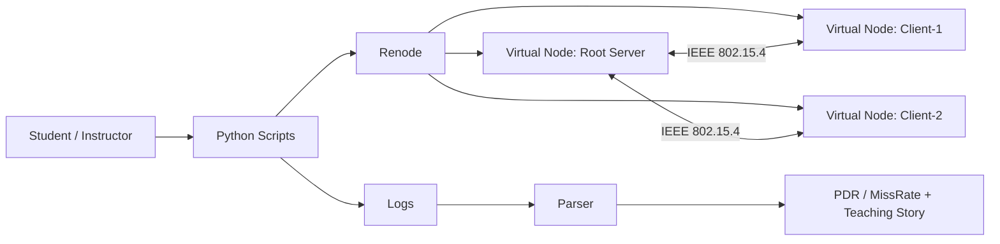
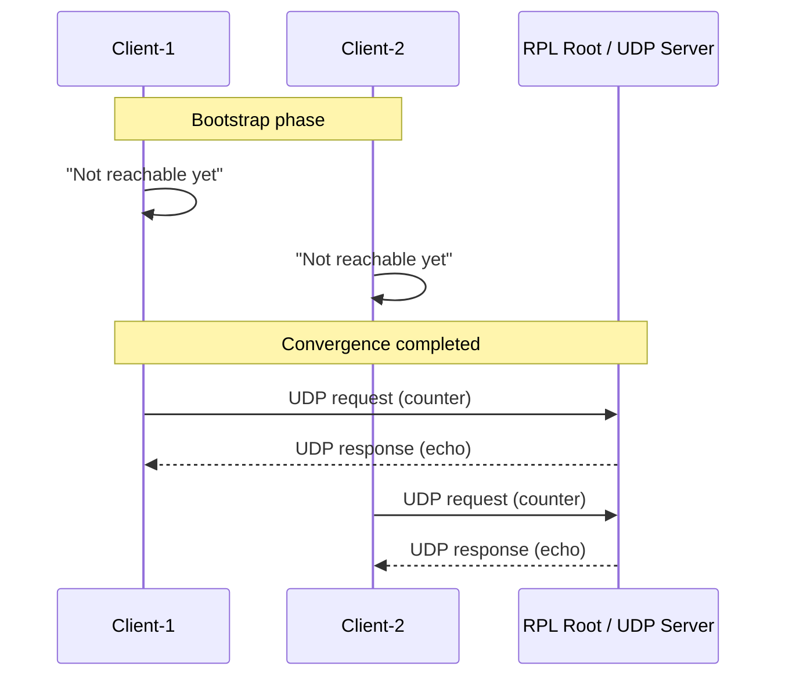
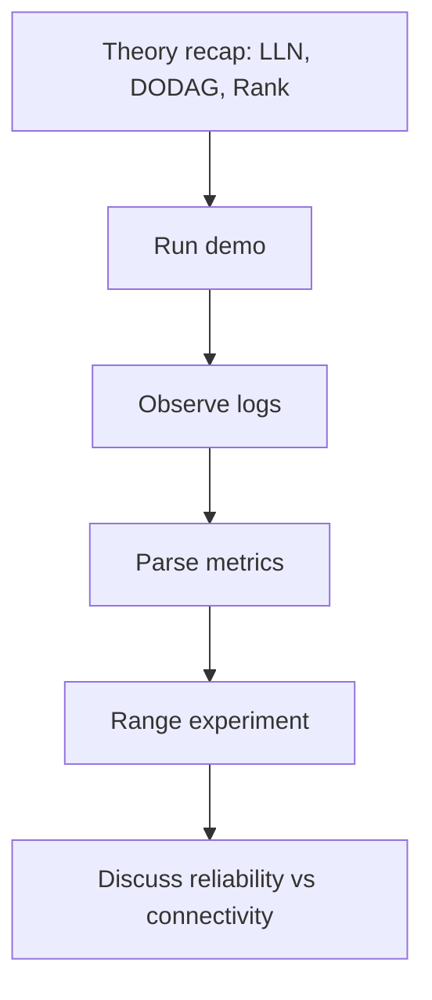
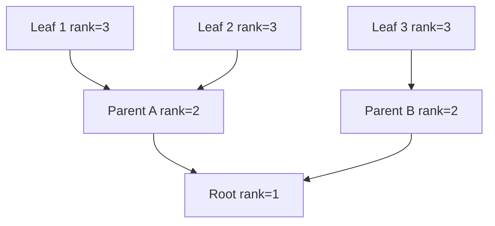
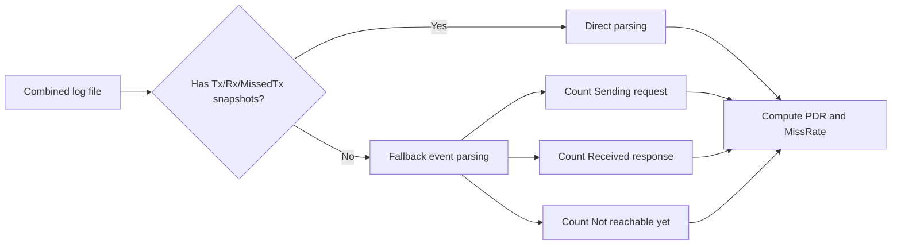

# Contiki RPL Lab for Industrial IoT Course

Hands-on repository to **teach and demonstrate RPL** with Contiki-NG and Renode.

This project is designed for classroom usage:
- short theory recap (what RPL is and why we use it),
- step-by-step lab instructions,
- reproducible experiments,
- scripts to automate runs and explain results to students.

---

## Visual overview (Mermaid)

### A) Lab architecture



### B) RPL behavior in this lab



### C) Teaching workflow



---

## 1) Learning goals

After this lab, students should be able to:
- explain what problem RPL solves in Low-power and Lossy Networks (LLNs),
- describe RPL roles (root, parents, leaf nodes) and DODAG formation,
- run a multi-node RPL scenario in Renode,
- interpret logs and calculate simple reliability metrics (`PDR`, `MissRate`),
- reason about how radio range and topology affect routing performance.

---

## 2) RPL theory (simple explanation)

### 2.1 Why RPL exists

Traditional routing protocols are often too heavy for IoT devices:
- little RAM/flash,
- low CPU power,
- battery constraints,
- unstable wireless links.

RPL is designed specifically for these constraints.

### 2.2 Core concepts

- **LLN (Low-power and Lossy Network)**: constrained nodes + unreliable links.
- **DODAG**: a directed acyclic graph built toward a destination (typically the root).
- **Root**: central reference node (in this lab, the UDP server).
- **Parent**: next-hop selected by each node according to an objective function.
- **Rank**: a logical distance from the root used to avoid loops.

Mermaid view of a simple DODAG:



### 2.3 RPL control messages (high-level)

- **DIS**: asks for routing information.
- **DIO**: advertises DODAG information.
- **DAO**: advertises downward reachability (used depending on mode).

For this lab, students do not need packet-level bit fields; behavior-level understanding is enough.

### 2.4 What students observe in this lab

In `rpl-udp`, clients initially print:
- `Not reachable yet`

Then, after convergence:
- `Sending request ...`
- server prints `Received request ...`
- clients print `Received response ...`

This transition is the visible effect of DODAG setup and route usability.

---

## 3) Repository structure

- `contiki-ng/`  
  Vendored Contiki-NG source tree (included in this repo).

- `run_rpl_lab_interactive.py`  
  Interactive experiment runner:
  1. generates `.resc` scripts in `contiki-ng/examples/rpl-udp/`,
  2. runs `make renode TARGET=cc2538dk SCRIPT=<file>.resc`,
  3. stores logs in `rpl_lab_runs/`.

- `parse_rpl_udp_logs.py`  
  Parser for:
  - `Tx/Rx/MissedTx` snapshots (preferred),
  - fallback combined-log parsing (`Sending request` / `Received response` / `Not reachable yet`).

- `run_renode_container_demo.sh` + `rpl-container-demo.resc`  
  One-command Docker demo (no local Renode install needed).

- `rpl_story_demo.py`  
  Presentation mode: converts log events into a 4-step protocol narrative.

- `lab - RPL.pdf` / `lab - RPL.pptx`  
  Slide material.

---

## 4) Prerequisites

Install:
- Python 3.9+
- Git
- **One of**:
  - local Renode installation, or
  - Docker (for containerized demo)

Optional but recommended:
- Wireshark (if you want traffic-level inspection in supported setups).

---

## 5) Teaching flow (suggested 90-minute class)

### Part A - Theory intro (15-20 min)
- Explain LLN constraints and why classic routing is not ideal.
- Introduce DODAG, root, parent, rank.
- Explain what students should see in logs during convergence.

### Part B - Live demo (15 min)
- Run `python3 rpl_story_demo.py --run`.
- Show the 4 protocol phases from real execution logs.

### Part C - Hands-on baseline (20 min)
- Students run baseline scenario and parse metrics.

### Part D - Parameter experiment (25 min)
- Students run range experiment (`5,8,11,14`) and compare metrics.

### Part E - Discussion (10 min)
- Which range values break reliability?
- Why does “not reachable yet” appear?
- How does this map to RPL convergence?

---

## 6) Quick start (step-by-step)

Run all commands from repository root.

### Step 1 - Verify bundled Contiki path

Check that this exists:
- `./contiki-ng/examples/rpl-udp`

### Step 2 - Baseline experiment

```bash
python3 run_rpl_lab_interactive.py \
  --contiki-path /absolute/path/to/this-repo/contiki-ng \
  --mode baseline \
  --run-seconds 90
```

### Step 3 - Parse baseline log

```bash
python3 parse_rpl_udp_logs.py --combined /absolute/path/to/this-repo/rpl_lab_runs/baseline_range11.log
```

### Step 4 - Explain results to students

Map logs to protocol phases:
1. `Not reachable yet` -> network not converged yet.
2. `Sending request` -> route available to root.
3. `Received request` on server -> forwarding works.
4. `Received response` on client -> end-to-end path is functional.

---

## 7) Container demo (no local Renode required)

Single command:

```bash
./run_renode_container_demo.sh
```

This will:
1. start Renode in Docker,
2. run a 30-second virtual-time scenario,
3. save log to `demo-runs/container-demo.log`,
4. print parsed summary.

Then run storytelling mode:

```bash
python3 rpl_story_demo.py --log demo-runs/container-demo.log
```

---

## 8) Main experiment for students: range sensitivity

### Run experiment

```bash
python3 run_rpl_lab_interactive.py \
  --contiki-path /absolute/path/to/this-repo/contiki-ng \
  --mode range \
  --ranges 5,8,11,14 \
  --run-seconds 90
```

### Parse all runs

```bash
python3 parse_rpl_udp_logs.py --combined /absolute/path/to/this-repo/rpl_lab_runs/range5.log
python3 parse_rpl_udp_logs.py --combined /absolute/path/to/this-repo/rpl_lab_runs/range8.log
python3 parse_rpl_udp_logs.py --combined /absolute/path/to/this-repo/rpl_lab_runs/range11.log
python3 parse_rpl_udp_logs.py --combined /absolute/path/to/this-repo/rpl_lab_runs/range14.log
```

### What students should report

Use a table with:
- `Range`
- `AvgPDR`
- `AvgMissRate`
- `Observation` (short explanation)

Expected trend:
- lower range -> harder connectivity -> higher misses / lower effective reliability.

---

## 9) Metrics explained (for lecture)

- `Tx`: number of requests sent by clients.
- `Rx`: number of responses received by clients.
- `MissedTx`: times clients were not ready/reachable when send cycle occurred.
- `PDR = Rx / Tx`: delivery success ratio.
- `MissRate = MissedTx / Tx`: reachability instability proxy.

Important teaching note:
- In short runs, `Tx/Rx/MissedTx` snapshots may be sparse.
- The parser fallback computes approximate counters from event lines.

Metrics pipeline:



---

## 10) Presentation command (one-liner)

If you need one command in class:

```bash
python3 rpl_story_demo.py --run
```

This gives:
- reproducible run,
- parsed metrics,
- plain-language RPL narrative you can read live.

---

## 11) Troubleshooting

- `renode: command not found`  
  Use Docker demo (`run_renode_container_demo.sh`) or install Renode locally.

- `Cannot find .../examples/rpl-udp`  
  Wrong `--contiki-path`; point it to `./contiki-ng`.

- No `Tx/Rx/MissedTx` lines found  
  Increase run duration (`--run-seconds 120`) and use combined-log fallback parser.

- Docker mount issues on macOS  
  Demo script already uses `/tmp` workaround for `.resc` mounting.

---

## 12) Reproducibility checklist (for grading)

For each student/group run, save:
- repository commit hash (`git rev-parse HEAD`),
- Renode version (`renode -v` or container image tag),
- run mode (`baseline` / `range`),
- parameter values (`ranges`, `run-seconds`),
- parsed output and final table.

This ensures comparable and reproducible results across student machines.

